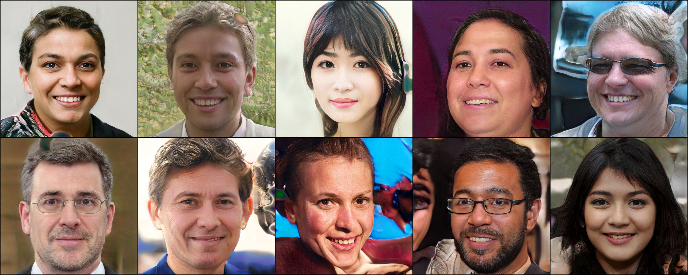

# StyleGAN v1 From Scratch (PyTorch)

A from-scratch PyTorch implementation of **StyleGAN v1**, trained on Kaggle using 2 GPUs with Distributed Data Parallel (DDP). The model uses progressive growing to generate images at resolutions up to **512×512**.

## Results

<p style="text-align: center;">
  
</p>

**Training Progress:** [Watch the video](https://chatgpt.com/c/output.mp4)

## Features

* Progressive growing from 4×4 up to 512×512 resolution.
* Style-based generation with a mapping network and noise injection.
* Distributed training using 2 GPUs.
* FID score evaluation during training.

## Requirements

Install the required dependencies:

```bash
pip install -r requirements.txt
```

## Training

Run training on a machine with 2 available GPUs:

```bash
torchrun --standalone --nproc_per_node=2 train.py
```

The model was trained on Kaggle. You can view the notebook here:

[**Kaggle Notebook**](https://chatgpt.com/c/YOUR_KAGGLE_NOTEBOOK_URL)

## Model Weights & Inference

**Pretrained weights are not included.** Training saves `checkpoint.pt` and `save_best.pt` in the working directory.

For inference, load the matching generator configuration and weights, then pass a random latent vector to the generator. For **512×512**, use `step=8`, `psi=0.7`, and `inference_mode=True`.

The generator output is in the `[-1, 1]` range and should be converted to an image format for visualization.
